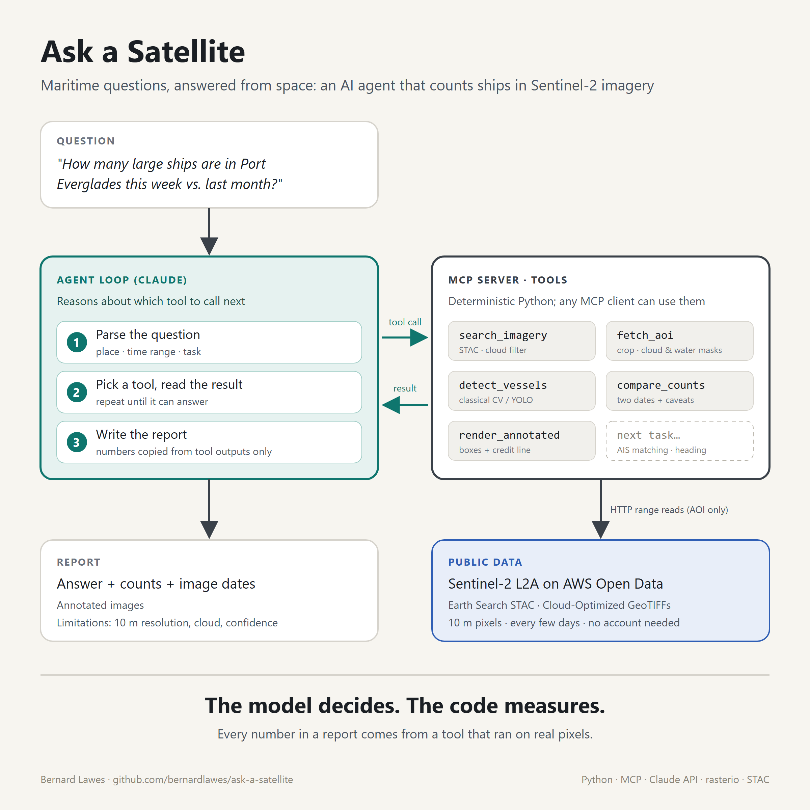

# Ask a Satellite

Maritime questions, answered from space: an AI agent that counts ships in Sentinel-2 imagery, and
shows its evidence.

> *"How many large ships are in Port Everglades this week, and how does that compare to last month?"*

<!-- TODO (M3): replace with a 30-60 s demo GIF -->


**Status:** work in progress, built in public. Milestone 1 (imagery pipeline + classical detector
baseline) is complete. Milestone 2 (measuring accuracy against hand labels) is next. The agent and MCP
server are not built yet. See [docs/milestones.md](docs/milestones.md).

## Why it exists

Free satellite imagery has been available for years, but answering a simple question with it still
means finding cloud-free scenes, cropping, running a detector, and interpreting the results. This
project lets an LLM agent do the orchestration while deterministic tools do the measuring. Every number
in a report comes from code that ran on real pixels, never from the model.

## Results

| AOI | Date | Method | Precision | Recall | Conditions |
|---|---|---|---|---|---|
| TBD | TBD | classical | TBD | TBD | Filled in from hand-labelled test set (M2) |

## How it works

```
question → Claude agent (plans) → MCP tools → Sentinel-2 COGs on AWS → report
```

1. Parse the question into place, time range, and task.
2. `search_imagery`: STAC search on [Earth Search](https://earth-search.aws.element84.com/v1),
   filtered by cloud cover.
3. `fetch_aoi`: windowed reads of only the AOI from Cloud-Optimized GeoTIFFs, plus SCL cloud mask
   and NDWI water mask.
4. `detect_vessels`: large vessels only (about 50 m and up at 10 m resolution).
5. `compare_counts` and an annotated report with dates, counts, and limitations.

Details and the detection trade-offs (classical CV vs. YOLO) are in [docs/architecture.md](docs/architecture.md).

## Stack

Python 3.11+, uv, rasterio/GDAL, pystac-client, NumPy/SciPy, Pillow, pydantic. Coming next: the MCP
Python SDK, the Anthropic SDK (Claude), and Ultralytics YOLO (trained on Kaggle).

## Run it

```bash
uv sync
uv run pytest                 # offline unit tests
uv run pytest -m network      # live STAC smoke test
uv run ask-a-satellite aois
uv run ask-a-satellite search --aoi port-everglades --start 2026-09-01 --end 2026-10-27
uv run ask-a-satellite detect --aoi port-everglades --start 2026-09-01 --end 2026-10-27
```

`detect` writes an annotated PNG and a JSON result to `outputs/`. AOI crops are cached in `data/cache/`
(`--no-cache` to bypass). To build and score the hand-labelled test set, see [eval/README.md](eval/README.md):

```bash
uv run ask-a-satellite label-kit --aoi port-everglades --start 2026-04-01 --end 2026-10-27
uv run ask-a-satellite evaluate
``` Copy `.env.example` to `.env` to
change defaults. The agent (M3) will need `ANTHROPIC_API_KEY`.

## Data and licensing

- Imagery: Copernicus Sentinel-2 L2A via the AWS Open Data registry and the Element 84 Earth Search STAC
  API. Free and open under the Copernicus data policy. Images in this repo: *Contains modified
  Copernicus Sentinel-2 data (2026).*
- Code: MIT (see [LICENSE](LICENSE)).

## Limitations

- 10 m pixels: only large vessels are visible. Small boats are missed by design.
- One snapshot per overpass (~10:30 local solar time), every few days at best, and only on clear days.
- The classical detector rejects anything touching or within 60 m of land. That removes surf, piers,
  and roofs, but also misses ships berthed against a quay. Small clouds that the SCL mask misses are
  caught with a SWIR test. Small boats near the size floor are still counted. See
  [docs/dev-log.md](docs/dev-log.md).
- Counts are not validated yet. Precision and recall come in Milestone 2.
