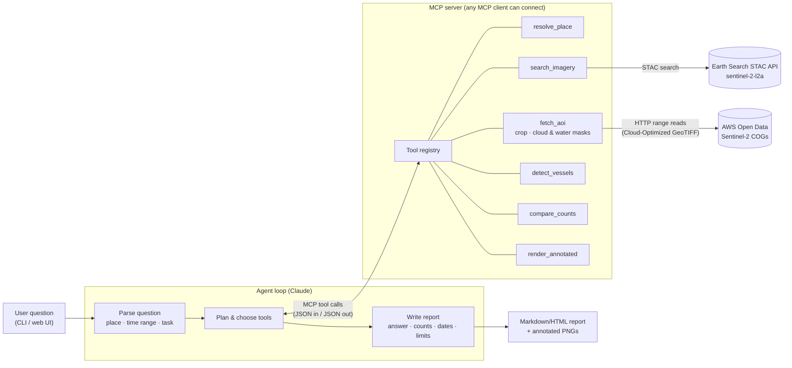

# Architecture

Ask a Satellite answers questions such as *"How many large ships are in Port Everglades this week,
and how does that compare to last month?"* using only public Sentinel-2 imagery.

The design has one rule: **the LLM decides, the code measures.** Claude parses the question and chooses
which tools to call. Every number in a report comes from a deterministic tool that ran on real pixels.

## System diagram

For the LinkedIn diagram, export this from [mermaid.live](https://mermaid.live) as SVG/PNG, or redraw it
in Excalidraw using the same boxes (see `docs/linkedin/post-1-the-idea.md`).

## Layers

| Layer | Package | Depends on | Notes |
|---|---|---|---|
| Core tools | `ask_a_satellite.tools` | numpy, rasterio, pystac-client | Pure Python functions with typed (pydantic) inputs/outputs. No LLM, no MCP. Fully unit-testable. |
| MCP server | `ask_a_satellite.mcp_server` | `mcp` SDK + core tools | Thin adapter: each tool becomes an MCP tool with a JSON schema. Large arrays stay server-side; tools exchange IDs and small JSON. |
| Agent | `ask_a_satellite.agent` | `anthropic` SDK + MCP client | Tool-use loop: send question + tool menu → Claude returns `tool_use` blocks → run them over MCP → feed results back → repeat until it writes the final answer. |
| Interfaces | `ask_a_satellite.cli`, later `web/` | agent or tools | CLI first. `detect` runs the pipeline with no LLM (useful for Post 2 and debugging). `ask` runs the agent. |

Keeping core tools separate from MCP and the agent means:
- tests run offline on synthetic rasters,
- the same tools work from Claude Desktop, Claude Code, or any other MCP client,
- a new task (crop health, change detection) is a new module in `tools/` plus one MCP registration.

## Data flow for one detection

1. **search_imagery**: STAC query on Earth Search (`sentinel-2-l2a`) by AOI bbox and date range, with
   `eo:cloud_cover < N` for the whole scene. Returns scene IDs, dates, cloud cover, and band hrefs.
2. **fetch_aoi**: windowed reads of `green`, `red`, `blue`, `nir` (10 m) and `scl` (20 m, resampled to 10 m)
   from the COGs. Only the AOI window is downloaded (a few hundred KB), not the 100 km tile.
   DN values are converted to reflectance with the asset's `raster:bands` scale/offset.
3. **AOI-level quality**: scene-level cloud cover is often misleading for a small AOI, so the cloud fraction
   *inside the AOI* is computed from SCL classes (cloud shadow, medium/high cloud, cirrus). Scenes over a
   threshold are rejected and the reason is recorded.
4. **detect_vessels**: see below. Each detection has a pixel box, lon/lat, size estimate, and a heuristic score.
5. **render_annotated**: true-colour PNG with numbered boxes and the Copernicus credit line.
6. **compare_counts**: counts for two dates, with caveats when observing conditions differ (cloud,
   valid water area).

## Vessel detection approach at 10 m

At 10 m GSD a 100 m vessel covers roughly 10×2 pixels, and a 300 m cruise ship roughly 30×4. Smaller boats
show up as one or two pixels, or not at all. The target is therefore **large vessels only (about 50 m and up)**,
and every report says so.

| Option | Strengths | Weaknesses |
|---|---|---|
| **A. Classical CV**: NDWI water mask, NIR-bright anomaly test inside the water area, connected components, size/shape filters | No training data or GPU, transparent, fast on CPU, every decision can be explained in a post | False positives from piers, wakes, breakwaters, clouds/sun-glint; berthed ships touching land are hard to separate from the quay |
| **B. YOLO fine-tuned** on a public Sentinel-2 ship dataset | Learns context (ship vs. pier vs. wake), handles berthed ships better, confidence scores are calibrated against labels | Needs labelled 10 m data (few public sets; licence must be checked), GPU training (Kaggle), small-object regime is hard for stock YOLO (needs upsampled tiles / small anchors), less transparent |
| **C. Both** (recommended) | Classical is the baseline and fallback, and makes labelling faster (pre-annotations to correct in Roboflow). YOLO is evaluated against the same hand-labelled test set. The tool reports `method` | More work, but the comparison is itself good content for Post 2 |

**Decision:** ship **A** in Milestone 1 so the whole pipeline runs end to end on real data. Add **B** in
Milestone 2 and make the detector a parameter of `detect_vessels` (`method="classical" | "yolo"`).
Candidate data: the public S2-SHIPS dataset (Sentinel-2, ship masks) plus our own small hand-labelled set
for the two ports (also the test set). **The licence and terms of any dataset will be verified before use.**
Training runs in a Kaggle notebook (`notebooks/`). Inference is CPU-only locally, which is fine at AOI size.

### Classical detector, step by step (`tools/vessels.py`)

1. `NDWI = (green − nir) / (green + nir)` → `water = NDWI > t_water`.
2. **Sea area**: keep only large connected water bodies (≥ 0.2 km², which drops pools and shadows on
   land), close with a small radius (20 m), and fill only *ship-sized* holes (≤ 600 px). A dark hull
   leaves a hole in the water mask, while larger holes are islands. (Unrestricted closing and filling
   leaked onto canal-laced neighbourhoods in the first real runs. See `docs/dev-log.md`.)
3. **Candidates** = `sea & ¬cloud & nir > max(water_median + k·MAD(water), floor)`. This is a simple
   CFAR-style test against the local water background. There is deliberately no `¬water` term: white
   hulls reflect green ≈ NIR, so their NDWI is ≈ 0 and many hull pixels pass the water test.
4. Connected components → filter by area, reject blobs mostly within 30 m of land (surf, jetties,
   mixed shore pixels), then measure centroid, major-axis length (from image moments), and contrast.
5. **Score**: a 0–1 heuristic from contrast and size, not a probability. Reports call it a "score".

Known failure modes are documented, not hidden: piers and moored barges, breaking wakes, sun-glint,
ships side by side merging into one blob, and ships hidden by cloud.

## Honesty guarantees (enforced in code, not only in prompts)

- Tools return `DetectionResult` objects with `scene_id`, acquisition `datetime`, AOI cloud fraction,
  valid-water fraction, method, and parameters. The report template renders these fields directly.
- The agent's final answer is checked against the tool outputs. Counts in the narrative must match
  `count` fields (Milestone 3 adds a validator that fails the run if they don't).
- No result means no number: if every scene is cloudy, the answer says so.
- Every image carries "Contains modified Copernicus Sentinel-2 data (YEAR)".

## Configuration and secrets

All configuration comes from environment variables (see `.env.example`). `ANTHROPIC_API_KEY` is only needed
for the agent (Milestone 3). Imagery access needs no credentials (`AWS_NO_SIGN_REQUEST=YES`).

## Extending with new tasks

A new task adds:
1. a function in `tools/` with pydantic input/output models and unit tests,
2. an MCP registration in `mcp_server/` (name, description, schema),
3. a report section renderer.

The agent's system prompt does not list tasks. It discovers them from the MCP tool menu. Examples:
`crop_health` (NDVI time series over a field polygon), `detect_change` (NDWI/NDBI differencing between
two dates).
